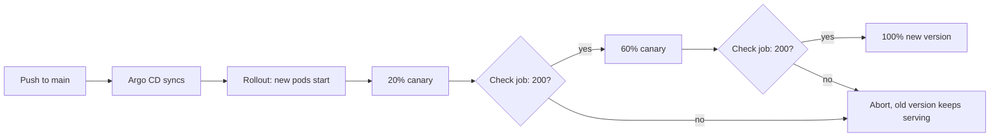

# gitops-canary-rollouts

[](https://github.com/gkakkineni-devops/gitops-canary-rollouts/actions/workflows/ci.yml)

A small Helm chart that releases a web service as a canary with Argo Rollouts, and an Argo CD Application that keeps a cluster in sync with this repo.

This is a practice project. It uses a public demo image (`argoproj/rollouts-demo`), not code from my job.

## What happens on a release

1. You change the image tag in `charts/demo-service/values.yaml` and push to `main`.
2. Argo CD sees the change and syncs it.
3. Argo Rollouts starts the new version beside the old one: 20% first, then 60%, then everything. It pauses between steps.
4. While it pauses, a small check job sends requests to the canary and expects a 200 each time. If the check fails, the release stops and the old version keeps serving.
5. If the new pods never become ready (a bad image tag, say), the release is aborted after `progressDeadlineSeconds` and users stay on the old version.



The boxes are the steps in `charts/demo-service/values.yaml`. The check job is the AnalysisTemplate.

## Layout

```
charts/demo-service/    Helm chart: Rollout, two Services, AnalysisTemplate
argocd/application.yaml Argo CD Application (auto-sync, prune, self-heal)
scripts/e2e.sh          the release test that CI runs
.github/workflows/      CI
```

## Try it yourself

You need a cluster (kind works), Helm, and Argo Rollouts installed.

```
kubectl create namespace argo-rollouts
kubectl apply -n argo-rollouts -f https://github.com/argoproj/argo-rollouts/releases/latest/download/install.yaml
helm install demo charts/demo-service -n demo --create-namespace
kubectl argo rollouts get rollout demo -n demo --watch
```

Then release a new version: `helm upgrade demo charts/demo-service -n demo --set image.tag=yellow` and watch it step through.

To use Argo CD instead, install it and apply `argocd/application.yaml`.

## How it's tested

CI does two things on every push.

**Lint and validate.** `helm lint --strict`, render the chart, check the output against the Kubernetes and Argo schemas with kubeconform, and run a Trivy config scan.

**Release test on a real cluster.** CI starts a kind cluster, installs Argo Rollouts, then `scripts/e2e.sh`:

- installs the chart,
- ships a good release and checks it finishes healthy on the new version,
- ships a release with an image tag that doesn't exist and checks the rollout fails,
- checks the stable service still answers with a 200 and the pods are still on the last good version.

## Limits

- Traffic is split by replica count, not by a traffic router, so 20% is approximate. A real setup would use an ingress or service mesh for exact weights.
- The check job only tests that the canary answers with a 200. A real service should check error rate and latency from metrics.
- I haven't pointed this at a cloud cluster. CI runs it on kind.

## What I'd do next

- Make the check read real numbers. A small AnalysisTemplate that asks Prometheus for the canary's error rate and latency would be a better gate than "did it answer with a 200", and it could sit behind a values flag so the simple check stays the default.
- Put an ingress or a service mesh in front so the weights are exact instead of following replica counts.
- Run the Argo CD Application against a cluster in CI too, so the sync path gets tested and not only the Helm release.

## License

MIT
